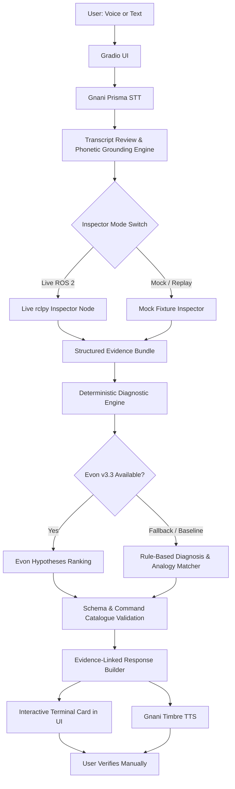

# 🤖 RoboSahaya — Voice-First ROS 2 Debugging Copilot

> **Speak the problem. Inspect the evidence. Find the next step.**  
> *Built for the **Great Indian AI Internship Challenge 2026** by Gnani AI.*

---

## 📌 Executive Summary

**RoboSahaya** is a voice-first debugging copilot designed for robotics engineers and students working with **ROS 2** robots and simulations. When a robot fails silently—such as moving without processing sensor scans, dropping messages due to QoS incompatibilities, or breaking coordinate transforms—RoboSahaya translates natural-language spoken complaints (in **English** or code-mixed **Telugu-English**) into an evidence-backed diagnostic sequence and safe manual verification steps.

### 🌟 Core Design Principles
1. **Evidence Before Explanation:** Every hypothesis is explicitly tied to atomic, verifiable observations (`[E1]`, `[E2]`).
2. **Plain-Language Intuition for Judges & Evaluators:** Cryptic robotics failures are accompanied by real-world physical analogies (e.g. QoS mismatches explained as AM vs FM radio walkie-talkies).
3. **Ergonomic Two-Channel Output:** 
   - **Voice Script (Gnani Timbre TTS):** Short, natural, conversational explanation for speech (no spoken terminal command strings).
   - **Interactive Terminal Card:** Detailed evidence list, confidence levels, caveats, and safe copyable CLI verification commands.
4. **Safety First:** Read-only inspection. The AI never controls motors, modifies files, or executes arbitrary shell code.
5. **Zero-Dependency Evaluator Mode (`--mock-mode`):** Allows judges on Windows, macOS, or clean Linux machines without ROS 2 installed to test and reproduce the full voice-to-diagnosis pipeline effortlessly.

---

## 🏗️ System Architecture



---

## 🧪 The 5 Diagnostic Failure Cases

| Case | Scenario Name | Plain-Language Physical Analogy | Detection Mechanism |
|---|---|---|---|
| **Case A.1** | Missing Topic | *Tuning into a radio frequency with no transmitter assigned.* | Graph inspection returns `exists_in_graph: false`. |
| **Case A.2** | Missing Publisher | *A crowd of listeners waiting in a hall with microphones on, but no speaker has arrived.* | Topic exists, subscriber count $\ge 1$, but publisher count $= 0$. |
| **Case C** | Broken TF Transform Link | *A digital marionette where the shoulder has no connection to the elbow, preventing 3D hand placement.* | Bounded TF2 buffer lookup returns `LookupException` or missing frame link. |
| **Case D** | QoS Reliability Mismatch | *Two walkie-talkies on the same channel where one transmits AM and the other listens on FM.* | Offered `BEST_EFFORT` vs requested `RELIABLE` policy comparison. |
| **Case E** | Simulation-Time Divergence | *Two sprinters in a race where one reads real wall-clock time while the other reads a paused stopwatch.* | `/clock` is active, but target node reports `use_sim_time: false`. |

---

## 🗣️ Acoustic & Telugu-English Grounding Engine

Spoken voice input frequently distorts technical terms. RoboSahaya features an active phonetic grounding engine that automatically maps acoustic variations to canonical ROS 2 entities:

| Acoustic ASR Token | Grounded Canonical Entity | Entity Type |
|---|---|---|
| `"slash scan"`, `"slash can"`, `"lidar topic"` | `/scan` | Topic |
| `"command well"`, `"cmd vel"`, `"speed topic"` | `/cmd_vel` | Topic |
| `"base link"`, `"robot frame"`, `"chassis frame"` | `base_link` | TF Frame |
| `"the f static"`, `"tf static"` | `/tf_static` | Topic |
| `"o dom"`, `"odometry"` | `/odom` | Topic |
| `"use sim time"`, `"sim time"` | `use_sim_time` | Parameter |

### Code-Mixed (Telugu-English) Spoken Examples Tested:
- *"నా robot tirugutondi kani laser scan data ravatledu, why?"* $\rightarrow$ Target: `/scan`
- *"నా robot move avvatledu, cmd vel lo messages vastunnaya?"* $\rightarrow$ Target: `/cmd_vel`
- *"Time mismatch error vastondi navigation clock lo"* $\rightarrow$ Target: `use_sim_time`, `/clock`

---

## 🚀 Quickstart Guide

### 1. Prerequisites
- Python 3.11 or 3.12
- Optional: ROS 2 Jazzy (only required for `--mode live`; `--mode mock` runs on any OS)

### 2. Setup
```bash
# Clone the repository
cd /media/sunraku/workspace/gnani_ai

# Set up virtual environment
python3 -m venv .venv
source .venv/bin/activate

# Install dependencies
pip install -r requirements.txt
```

### 3. Configure Credentials (Optional)
Copy `.env.example` to `.env`:
```bash
cp .env.example .env
```
Fill in your `GNANI_API_KEY` from the [Gnani AI Dashboard](https://app.gnani.ai/voice). If no key is set, the application automatically runs with mock speech simulation for offline grading.

### 4. Run the Application
```bash
# Run in zero-dependency Mock Replay Mode (Instant evaluation):
python src/robosahaya/app.py --mode mock

# Or run in Live ROS 2 mode on a robot/simulation host:
python src/robosahaya/app.py --mode live
```
Open **`http://127.0.0.1:7860`** in your browser.

---

## 🧪 Running Automated Tests

RoboSahaya comes with a unit and integration test suite:

```bash
pytest tests/
```
Output:
```text
tests/integration/test_pipeline.py .                                     [  5%]
tests/unit/test_command_catalogue.py ...                                 [ 23%]
tests/unit/test_diagnostics.py .....                                     [ 52%]
tests/unit/test_grounding.py .....                                       [ 82%]
tests/unit/test_mock_inspector.py ...                                    [100%]
============================== 17 passed in 0.14s ==============================
```

---

## 📦 Approved Command Catalogue

The LLM is strictly prohibited from executing or hallucinating shell commands. All suggested verification steps map to an approved, read-only catalogue with dynamic argument regex sanitization:

- `list_nodes` $\rightarrow$ `ros2 node list`
- `list_topics` $\rightarrow$ `ros2 topic list -t`
- `topic_info` $\rightarrow$ `ros2 topic info <topic> --verbose`
- `param_get` $\rightarrow$ `ros2 param get <node> <param>`
- `tf_view_frames` $\rightarrow$ `ros2 run tf2_tools view_frames`
- `topic_hz` $\rightarrow$ `ros2 topic hz <topic>`
- `topic_echo_once` $\rightarrow$ `ros2 topic echo <topic> --once`

---

## 🏆 Great Indian AI Internship Challenge Details

- **Organizer:** Gnani AI
- **Models Utilized:** 
  - **Prisma (STT):** Multi-lingual Indian & Telugu-English speech-to-text.
  - **Timbre (TTS):** Indian-accented natural voice synthesis for hands-free diagnostic scripts.
  - **Evon (v3.3):** Open-weight reasoning integration specification.
- **Hashtags:** `#GnaniAI` `#GreatIndianAIInternshipChallenge`
- **License:** Apache 2.0
