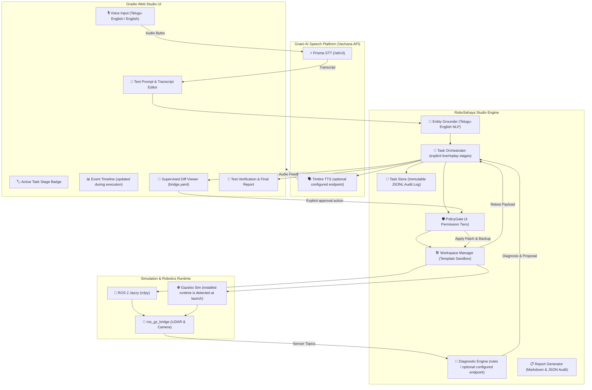

# 🤖 RoboSahaya Studio — Engineering Architecture & System Overview
> **"Speak it. Simulate it. Test it."**  
> *Evidence-led ROS 2 diagnosis with a supervised, managed simulation repair path.*

> **Implementation status:** This overview previously contained aspirational architecture and benchmark claims. The sections below describe the current implementation where updated; the old benchmark transcript and fixed-duration demo claims have been removed. Replay mode is not live ROS/Gazebo evidence.

---

## 1. Executive Summary

**RoboSahaya Studio** transforms robotics engineering from manual, error-prone command-line triage into an intuitive, supervised autonomous workflow. Instead of developers manually writing URDFs, configuring simulator bridges, parsing raw terminal outputs, and debugging cryptic TF/QoS failures, RoboSahaya Studio enables developers to describe what they want to build or fix in plain English or bilingual Telugu-English:

> *"నా robot launch ayyindi kani laser scan data ravatledu, test chesi fix chey."*  
> *(“My robot launched, but laser scan data is not arriving. Test it and fix it.”)*

In live mode, Studio expands the approved Xacro template, validates generated files, builds a task-local ament package, starts the registered Gazebo launch profile, and samples ROS messages. The optional demo fault creates a patch proposal in that generated workspace. The explicit approval action issues a one-time grant, applies a context-checked diff after verifying the base-file hash, rebuilds and relaunches, then samples sensor payloads again. Replay mode only runs fixture diagnostics and never reports runtime success.

---

## 2. High-Level System Architecture



---

## 3. Engineering Lifecycle

The live path records the stages it actually reaches. A blocked build or launch, failed sample, cancellation, or replay diagnosis is reported as such; no retest is synthesized.

| # | Task Stage | Description | Emitted Tool / Action |
|---|---|---|---|
| 1 | `RECEIVED` | User instruction received via voice or text | Intake & sanitization |
| 2 | `TRANSCRIBED` | Raw speech converted to verified text via Gnani Prisma | STT Contract validation |
| 3 | `PLANNING` | Execution strategy formulated (template, world, tests) | Plan synthesis |
| 4 | `PREPARING` | Task-isolated sandbox created from golden template | `assemble_simulation_template` |
| 5 | `BUILDING` | URDF/Xacro XML and bridge YAML parsed and validated | `validate_project_files` |
| 6 | `LAUNCHING` | Robot state publisher & sensor bridge started | `launch_simulation_profile` |
| 7 | `TESTING` | Initial sensor stream verification (LiDAR & Camera) | `sample_topic_messages` |
| 8 | `DIAGNOSING` | Multi-source graph inspection & root cause identification | Diagnostic Engine |
| 9 | `PATCH_PROPOSED` | Minimal diff computed with SHA-256 digest | `propose_patch` |
| 10 | `AWAITING_APPROVAL` | Execution paused; human review required (Tier 2 Gate) | Diff Viewer |
| 11 | `PATCH_APPROVED` | Approval token verified against SHA-256 diff hash | PolicyGate Verification |
| 12 | `PREPARING` | Backup (`.bak`) created; atomic patch applied | `apply_reviewed_patch` |
| 13 | `RE_TESTING` | Named verification test executed on repaired pipeline | `run_named_test` |
| 14 | `COMPLETED` | Payload metrics verified; final audit report rendered | `generate_report` |
| — | `FAILED` | Terminal error state with actionable diagnostics | Error boundary |
| — | `BLOCKED` | Required ROS/Gazebo or build capability unavailable | Environment check |
| — | `PARTIAL_SUCCESS` | Replay diagnosis completed without runtime actions | Fixture inspector |
| — | `CANCELLED` | User abort via stop button or rejection | Task cancellation |

---

## 4. Key Subsystems & Deliverables

### A. 4-Tier Security Policy Gate (`policy_gate.py`)
To prevent unauthorized or destructive operations:
- **Tier 0 (Read-Only)**: Graph inspection (`list_ros_nodes`, `get_topic_info`, `lookup_tf_transform`).
- **Tier 1 (Workspace Build/Test)**: Syntax validation (`validate_project_files`), template assembly, test runs.
- **Tier 2 (Managed Sim & Patch)**: Simulation lifecycle, diff application requiring cryptographic user token.
- **Tier 3 (Permanently Blocked)**: Arbitrary shell execution (`run_shell`, `exec`), `sudo`, system package installations, directory escapes (`..`), symlink breakouts, and physical hardware control topics (`/cmd_vel`).
- **One-time Diff Approval**: A random, process-local grant is issued by the explicit approval handler and bound to the patch ID and exact diff digest. The target path is resolved inside the generated workspace and its base-file SHA-256 must still match.

### B. Simulation Golden Templates (`simulation/`)
- **Robot Model (`differential_drive/model.urdf.xacro`)**: Differential-drive robot with LiDAR and camera tags; Xacro is expanded during assembly. Runtime performance depends on the installed simulator and is measured from messages, not assumed from model settings.
- **Bridge Configuration (`differential_drive/bridge.yaml`)**: Bidirectional mappings between Gazebo transport topics and ROS 2 Jazzy topics (`sensor_msgs/msg/LaserScan`, `sensor_msgs/msg/Image`).
- **Simulation World (`obstacle_course/obstacle_world.sdf`)**: Enclosed obstacle arena designed for realistic LiDAR surface returns and collision verification.

### C. Live Gnani AI Voice Pipeline (`gnani_client.py`)
- **STT**: Calls the configured STT URL with an `X-API-Key-ID` credential.
- **TTS**: Calls the configured TTS URL with a separate bearer credential; service responses are not marked connected until a request succeeds.
- **Speech Review**: Typed input remains available when speech services are unconfigured; no audio is simulated.

### D. Bilingual Entity Grounding & Optional Reasoning Adapter (`grounding.py`, `evon_adapter.py`)
- Resolves code-mixed terminology (e.g. *“tirugutondi”* → rotation/odometry, *“ravatledu”* → missing data, *“laser scan”* → `/scan`).
- Reasoning uses deterministic rules unless an operator configures an endpoint and credentials. Local model metadata is reported only when corresponding files are present; no Evon version, parameter count, or context size is assumed.

### E. Diagnostic Engine: 5 Canonical Classes
1. **Missing Topic / Bridge / Sensor Messages**: Distinguishes absent topics, 0-publisher endpoints, and bridge mapping discrepancies.
2. **Missing Node**: Graph topology inspection and namespace verification.
3. **TF Coordinate Frame Failure**: Bounded transform tree lookups detecting disconnected frames or timestamp extrapolation.
4. **QoS Compatibility Incompatibility**: Evaluates offered vs requested Reliability (`BEST_EFFORT` vs `RELIABLE`) and Durability (`VOLATILE` vs `TRANSIENT_LOCAL`).
5. **Simulation Clock Divergence**: Checks `use_sim_time` configuration and `Clock` drift.

### F. Engineering Report Generator (`report_generator.py`)
- Emits structured Markdown and JSON audit reports.
- Includes problem statements, ordered timestamped event tables, evaluated hypotheses, measured sensor throughput metrics, patch diffs, and verification confirmations.
- Applies common-pattern redaction to report text. Redaction is best effort and should not be treated as a guarantee for arbitrary secret formats.

---

## 5. Web Application User Interface (`ui.py`)

The application runs a unified, modern web interface on port `7860`:
1. **Tab 1: 🚀 Autonomous Engineering Studio**:
   - Voice microphone / file upload input with editable transcript.
   - Pre-loaded one-click test queries (LiDAR Repair in Telugu-English, Camera test).
   - Real-time Stage Badge and Timeline table.
   - Diagnostic root cause card with plain-language analogies.
   - Interactive Diff Reviewer with **"Approve Patch & Retest"** and **"Reject Patch"** buttons.
   - Automated Timbre TTS audio telemetry on milestone events.
   - Retest payload validation metrics and exportable Markdown report.
2. **Tab 2: 🔍 Diagnostic Copilot (Read-Only Inspection)**:
   - Dedicated read-only ROS 2 graph inspector with generative Evon reasoning and rule baselines.

---

## 6. Verification & Benchmarking

The repository includes fixture-based diagnostics and a benchmark runner. Running it records measurements for the current checkout; this document makes no fixed accuracy, latency, test-count, or live-runtime claims. The studio portion of the benchmark is explicitly marked not run because it requires a live ROS 2/Gazebo session.

---

## 7. How to Launch & Rehearse

### Launching the Web Studio
```bash
cd /media/sunraku/workspace/gnani_ai
source /opt/ros/jazzy/setup.bash
PYTHONPATH=src python -m robosahaya.app --mode live --host 127.0.0.1 --port 7860
```
Open **`http://127.0.0.1:7860`** in any web browser.

### Running the Full Evaluation Benchmark
```bash
.venv/bin/python evaluation/run_benchmark.py
```

### Running All Unit & Integration Tests
```bash
.venv/bin/pytest --cov=robosahaya tests/
```

---

## 8. 60-Second Competition Demo Script Walkthrough

| Timestamp | Visual Action | Telemetry / Audio |
|---|---|---|
| **00:00 – 00:08** | Split screen: Gazebo Harmonic robot on left; RoboSahaya Studio on right. | User speaks in Telugu-English: *"నా robot launch ayyindi kani laser scan data ravatledu, test chesi fix chey."* |
| **00:08 – 00:18** | If credentials are configured, STT may populate the prompt; the grounder highlights a recognized target. | UI stages reflect events as they are emitted. |
| **00:18 – 00:30** | Live mode builds and launches the generated workspace, then samples `/scan` and `/camera/image_raw`. | Diagnosis is based on observed graph and sample evidence; launch or sample failures remain failures. |
| **00:30 – 00:44** | When the user enabled the demo fault and live testing proposes a patch, the diff opens with its digest and file target. | User chooses **Approve Patch & Retest** or rejects it. A one-time grant is created only on approval. |
| **00:44 onward** | The workspace is rebuilt and relaunched; test values come from new ROS messages. | A completed status requires successful live payload sampling. No fixed timing or rate is promised. |
| **Replay mode** | Fixture diagnostics are shown without build or launch. | The report is labeled replay only and does not claim live verification. |
