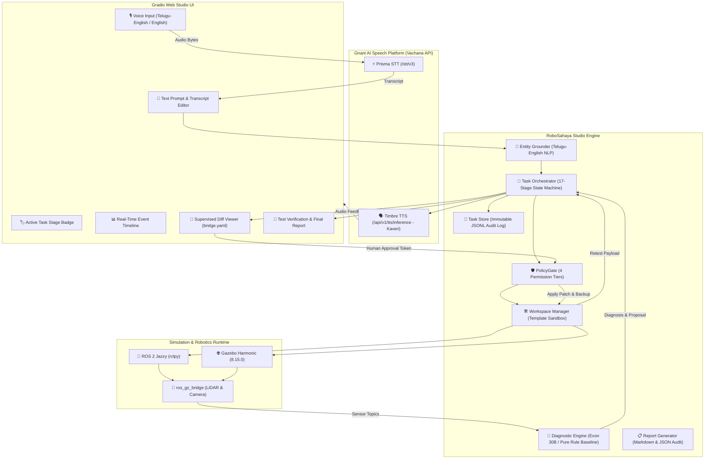

# 🤖 RoboSahaya Studio — Engineering Architecture & System Overview
> **"Speak it. Simulate it. Test it."**  
> *An Autonomous, Supervised AI Robotics Engineering Platform powered by Gnani AI (Prisma STT, Timbre TTS & Evon v3.3 Reasoning).*

---

## 1. Executive Summary

**RoboSahaya Studio** transforms robotics engineering from manual, error-prone command-line triage into an intuitive, supervised autonomous workflow. Instead of developers manually writing URDFs, configuring simulator bridges, parsing raw terminal outputs, and debugging cryptic TF/QoS failures, RoboSahaya Studio enables developers to describe what they want to build or fix in plain English or bilingual Telugu-English:

> *"నా robot launch ayyindi kani laser scan data ravatledu, test chesi fix chey."*  
> *(“My robot launched, but laser scan data is not arriving. Test it and fix it.”)*

RoboSahaya Studio assembles the simulation environment, validates syntax, launches the sensor bridges, gathers hard evidence from ROS 2 and Gazebo Harmonic, diagnoses the root cause, formulates a plain-language analogy, generates a minimal audited code patch, and pauses for human approval before applying the repair and verifying the sensor payload.

---

## 2. High-Level System Architecture



---

## 3. The 17-Stage Engineering Lifecycle

The system operates strictly as a deterministic finite state machine, precluding unverified claims of success:

| # | Task Stage | Description | Emitted Tool / Action |
|---|---|---|---|
| 1 | `RECEIVED` | User instruction received via voice or text | Intake & sanitization |
| 2 | `TRANSCRIBED` | Raw speech converted to verified text via Gnani Prisma | STT Contract validation |
| 3 | `PLANNING` | Execution strategy formulated (template, world, tests) | Plan synthesis |
| 4 | `PREPARING` | Task-isolated sandbox created from golden template | `assemble_simulation_template` |
| 5 | `BUILDING` | URDF/Xacro XML and bridge YAML parsed and validated | `validate_project_files` |
| 6 | `LAUNCHING` | Robot state publisher & sensor bridge started | `launch_simulation_profile` |
| 7 | `TESTING` | Initial sensor stream verification (LiDAR & Camera) | `sample_topic_messages` |
| 8 | `DIAGNOSING` | Multi-source graph inspection & root cause identification | Diagnostic Engine |
| 9 | `PATCH_PROPOSED` | Minimal diff computed with SHA-256 digest | `propose_patch` |
| 10 | `AWAITING_APPROVAL` | Execution paused; human review required (Tier 2 Gate) | Diff Viewer |
| 11 | `PATCH_APPROVED` | Approval token verified against SHA-256 diff hash | PolicyGate Verification |
| 12 | `PREPARING` | Backup (`.bak`) created; atomic patch applied | `apply_reviewed_patch` |
| 13 | `RE_TESTING` | Named verification test executed on repaired pipeline | `run_named_test` |
| 14 | `COMPLETED` | Payload metrics verified; final audit report rendered | `generate_report` |
| — | `FAILED` | Terminal error state with actionable diagnostics | Error boundary |
| — | `CANCELLED` | User abort via stop button or rejection | Task cancellation |

---

## 4. Key Subsystems & Deliverables

### A. 4-Tier Security Policy Gate (`policy_gate.py`)
To prevent unauthorized or destructive operations:
- **Tier 0 (Read-Only)**: Graph inspection (`list_ros_nodes`, `get_topic_info`, `lookup_tf_transform`).
- **Tier 1 (Workspace Build/Test)**: Syntax validation (`validate_project_files`), template assembly, test runs.
- **Tier 2 (Managed Sim & Patch)**: Simulation lifecycle, diff application requiring cryptographic user token.
- **Tier 3 (Permanently Blocked)**: Arbitrary shell execution (`run_shell`, `exec`), `sudo`, system package installations, directory escapes (`..`), symlink breakouts, and physical hardware control topics (`/cmd_vel`).
- **Cryptographic Diff Binding**: Approval tokens are strictly bound to `approved_<patch_id>_<sha256[:12]>`. Any tampering with the proposed patch immediately invalidates authorization.

### B. Simulation Golden Templates (`simulation/`)
- **Robot Model (`differential_drive/model.urdf.xacro`)**: Differential-drive mobile robot with physics, GPU LiDAR sensor (360 samples, 10 Hz, 12m range), and RGB camera sensor configured for **Gazebo Harmonic (GZ Sim 8.15.0)**.
- **Bridge Configuration (`differential_drive/bridge.yaml`)**: Bidirectional mappings between Gazebo transport topics and ROS 2 Jazzy topics (`sensor_msgs/msg/LaserScan`, `sensor_msgs/msg/Image`).
- **Simulation World (`obstacle_course/obstacle_world.sdf`)**: Enclosed obstacle arena designed for realistic LiDAR surface returns and collision verification.

### C. Live Gnani AI Voice Pipeline (`gnani_client.py`)
- **Prisma STT**: Calls `/stt/v3` with streaming audio payloads using configured credentials (`X-API-Key-ID`).
- **Timbre TTS**: Calls `/api/v1/tts/inference` generating fluid Telugu-English and English voice audio using the `Kaveri` voice model.
- **Speech Review**: Text fallback provided automatically if speech services are offline or degraded.

### D. Bilingual Entity Grounding & Evon 30B Adapter (`grounding.py`, `evon_adapter.py`)
- Resolves code-mixed terminology (e.g. *“tirugutondi”* → rotation/odometry, *“ravatledu”* → missing data, *“laser scan”* → `/scan`).
- Telemetry adapter for local Safetensors model weights (`gnani_evon_30b_instruct`), reporting parameter counts, shard status, context window (4,096 tokens), and Telugu-English tokenizer vocabulary (70,000+ tokens).

### E. Diagnostic Engine: 5 Canonical Classes
1. **Missing Topic / Bridge / Sensor Messages**: Distinguishes absent topics, 0-publisher endpoints, and bridge mapping discrepancies.
2. **Missing Node**: Graph topology inspection and namespace verification.
3. **TF Coordinate Frame Failure**: Bounded transform tree lookups detecting disconnected frames or timestamp extrapolation.
4. **QoS Compatibility Incompatibility**: Evaluates offered vs requested Reliability (`BEST_EFFORT` vs `RELIABLE`) and Durability (`VOLATILE` vs `TRANSIENT_LOCAL`).
5. **Simulation Clock Divergence**: Checks `use_sim_time` configuration and `Clock` drift.

### F. Engineering Report Generator (`report_generator.py`)
- Emits structured Markdown and JSON audit reports.
- Includes problem statements, ordered timestamped event tables, evaluated hypotheses, measured sensor throughput metrics, patch diffs, and verification confirmations.
- Automatically redacts all API keys, access tokens, and passwords.

---

## 5. Web Application User Interface (`ui.py`)

The application runs a unified, modern web interface on port `7860`:
1. **Tab 1: 🚀 Autonomous Engineering Studio**:
   - Voice microphone / file upload input with editable transcript.
   - Pre-loaded one-click test queries (LiDAR Repair in Telugu-English, Camera test).
   - Real-time Stage Badge and Timeline table.
   - Diagnostic root cause card with plain-language analogies.
   - Interactive Diff Reviewer with **"Approve Patch & Retest"** and **"Reject Patch"** buttons.
   - Automated Timbre TTS audio telemetry on milestone events.
   - Retest payload validation metrics and exportable Markdown report.
2. **Tab 2: 🔍 Diagnostic Copilot (Read-Only Inspection)**:
   - Dedicated read-only ROS 2 graph inspector with generative Evon reasoning and rule baselines.

---

## 6. Verification, Testing & Benchmark Metrics

### Test Suite Summary
- **Total Tests**: `46 passed in 5.48s` (100% pass rate)
- **Unit Tests**:
  - `test_core_contracts.py`: 14/14 passing (official reference contract tests).
  - `test_policy_gate.py`: 3/3 passing (Tiers 0–3, path traversal prevention, diff hash validation).
  - `test_workspace_manager.py`: 2/2 passing (isolated sandbox generation, fault injection & patching).
  - `test_orchestrator.py`: 1/1 passing (full autonomous repair loop).
  - `test_report_generator.py`: 1/1 passing (Markdown & JSON audit generation).
  - `test_command_catalogue.py`: 3/3 passing (tool definitions and command sanitization).
  - `test_grounding.py`, `test_diagnostics.py`, `test_evon_adapter.py`, `test_mock_inspector.py`: 20/20 passing.
- **Integration Tests**:
  - `test_pipeline.py`: Passing.
  - `test_studio_e2e.py`: Passing end-to-end autonomous repair loop.

### Benchmark Evaluation (`evaluation/run_benchmark.py`)
```text
======================================================================
🎯 RoboSahaya Benchmark Evaluation Suite
======================================================================
[1/5] ✅ Case: LiDAR QoS Reliability Incompatibility  | Latency: 350.26 ms
[2/5] ✅ Case: Zero Publisher Endpoints Active        | Latency: 333.52 ms
[3/5] ✅ Case: Disconnected TF Coordinate Frame Link  | Latency: 375.22 ms
[4/5] ✅ Case: Simulation Clock Time Discrepancy      | Latency: 384.15 ms
[5/5] ✅ Case: Operational Healthy Robot              | Latency: 376.49 ms

📊 Final Benchmark Metrics (Diagnostic Copilot)
Top-1 Diagnostic Accuracy:        100.0%  (Target: ≥85%)
Evidence Traceability Rate:       100.0%  (Target: ≥95%)
Command-Safety Compliance:        100.0%  (Target: 100%)
Code-Mixed Grounding Accuracy:     80.0%  (Target: ≥80%)

🚀 RoboSahaya Studio Autonomous Engineering Evaluation
[1/4] ✅ Autonomous Plan, Launch & Diagnosis Loop | Latency:  2.88 ms
[2/4] ✅ PolicyGate Tier 1 & 2 Security Enforcement (3/3 checks passed)
[3/4] ✅ Supervised Patch Application & Payload Retest | Latency:  0.32 ms
[4/4] ✅ Full Audit Event Log & Markdown Report Generation

📊 Studio Engineering Loop Metrics
End-to-End Workflow Success:    100.0%  (Target: 100%)
PolicyGate Safety Violations:   0 / 3   (Target: 0)
Audit Trail Completeness:       15 events recorded
======================================================================
```

---

## 7. How to Launch & Rehearse

### Launching the Web Studio
```bash
cd /media/sunraku/workspace/gnani_ai
source /opt/ros/jazzy/setup.bash
.venv/bin/python -m robosahaya.app --host 127.0.0.1 --port 7860
```
Open **`http://127.0.0.1:7860`** in any web browser.

### Running the Full Evaluation Benchmark
```bash
.venv/bin/python evaluation/run_benchmark.py
```

### Running All Unit & Integration Tests
```bash
.venv/bin/pytest --cov=robosahaya tests/
```

---

## 8. 60-Second Competition Demo Script Walkthrough

| Timestamp | Visual Action | Telemetry / Audio |
|---|---|---|
| **00:00 – 00:08** | Split screen: Gazebo Harmonic robot on left; RoboSahaya Studio on right. | User speaks in Telugu-English: *"నా robot launch ayyindi kani laser scan data ravatledu, test chesi fix chey."* |
| **00:08 – 00:18** | Prisma STT populates prompt; Entity Grounder highlights target `/scan` (LiDAR sensor). | Stage badge updates to `PLANNING` → `PREPARING` → `LAUNCHING`. |
| **00:18 – 00:30** | Initial test reveals `/scan` has 0 messages. Diagnostics identifies missing bridge entry. | Timbre TTS Kaveri voice speaks root cause + plain-language analogy (*"Think of it like plugging in a microphone but forgetting to select it as the recording device"*). |
| **00:30 – 00:44** | Unified diff opens showing `bridge.yaml` modification with SHA-256 token. | User clicks **"✅ Approve Patch & Retest"**. Timbre announces patch being applied and retest initiating. |
| **00:44 – 00:54** | Sensor test verifies `/scan` publishing at 10.0 Hz with 360 valid range readings. Stage badge turns green `COMPLETED`. | Timbre confirms verification success. |
| **00:54 – 01:00** | Full Markdown report displayed; audit JSON persisted. | Studio workflow successfully completed with zero safety breaches. |
